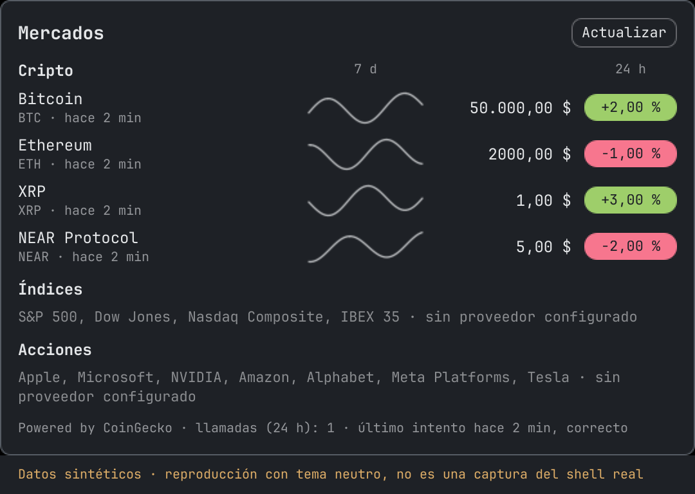
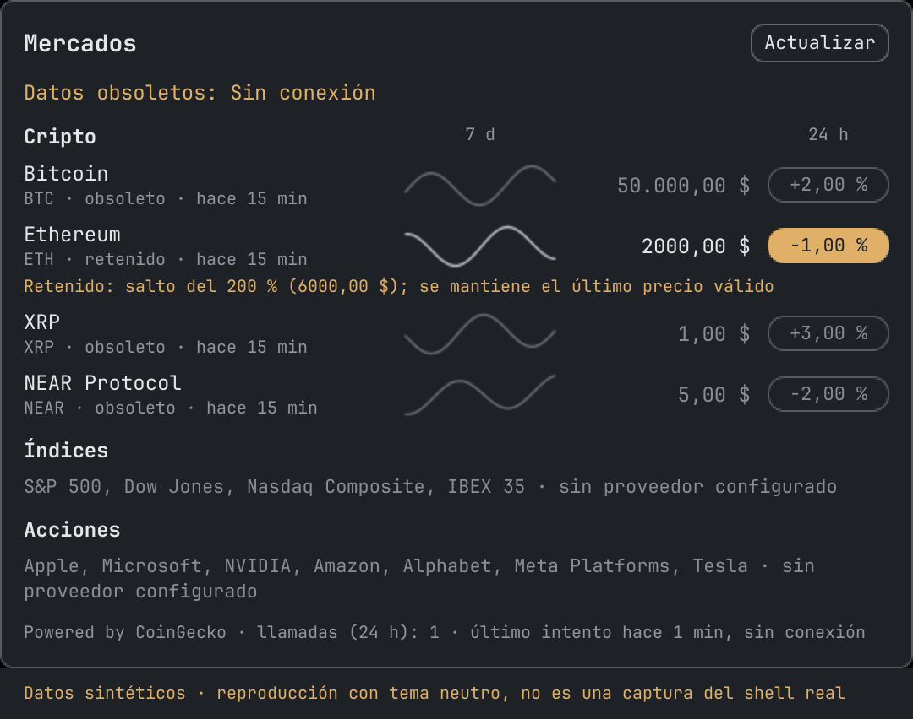

# PipeLine

Read-only market prices and sparklines for the [Omarchy](https://omarchy.org/) top bar.

A compact element in the bar shows up to three prices. Clicking it opens a panel with each symbol's
sparkline, price, variation and data age. It reads public data only, needs no account, and cannot
trade.

**This project is not financial advice.** It is not affiliated with, or endorsed by, CoinGecko, any
other data provider, or Omarchy. Prices can be delayed or wrong: do not base decisions on them.

Crypto prices are **Powered by [CoinGecko](https://www.coingecko.com)**.

## Screenshots





Synthetic data. Each image is a reproduction with a neutral theme, not a capture of the real shell:
`scripts/make_screenshots.py` draws the real panel code outside the shell, without network access
and without capturing the screen.

## Status

| Data | State |
|---|---|
| Crypto: BTC, ETH, XRP, NEAR | Working |
| Indices: S&P 500, Dow Jones, Nasdaq Composite, IBEX 35 | No provider yet; shown as unavailable |
| Stocks: AAPL, MSFT, NVDA, AMZN, GOOGL, META, TSLA by default | No provider yet; shown as unavailable |

The interface is in Spanish, with `es_ES` number formatting and the `Europe/Madrid` time zone by
default.

## Requirements

- Omarchy, with its Quickshell bar and a systemd user session
- Python 3.14 or newer
- `jq`, only for the optional `shell.json` change

Tested only on CachyOS, an Arch-based distribution, with Omarchy 4.0.6, Hyprland 0.57.0 and
Quickshell 0.3.2.

## Installation

From the repository folder, in this order:

```sh
python3 -m venv .venv
.venv/bin/pip install .
./install.sh --dry-run    # shows every change without making it
./install.sh
omarchy restart shell
```

`.venv/bin/pip install .` downloads the build tool from PyPI. PipeLine has no runtime dependencies.

`install.sh` runs without root and creates:

- `~/.local/share/pipeline`, with mode 700, for the database
- `~/.local/bin/pipeline`, a one-line launcher that runs the program in `.venv`
- the plugin, in `~/.config/omarchy/plugins/pipeline.market/`
- the systemd units, in `~/.config/systemd/user/`

It asks before replacing a different existing file and before enabling the timer. Without an answer,
it does neither.

To add the element to the bar, it shows a diff of `shell.json` and asks. If you accept, it keeps a
dated copy first. **It does not touch `shell.json` if it already has a `pipeline.market` entry**, or
if the file is missing or invalid. It never runs `omarchy plugin enable`, which would rewrite the
file without a copy.

Restart the shell after installing or updating the plugin, because
`omarchy-shell shell rescanPlugins` was not enough to load changed code:

```sh
omarchy restart shell
```

The scripts have been tested only on an Arch-based system with `bash` as `/bin/sh`, and they use GNU
`diff` and `stat`.

### Updating

```sh
git pull
.venv/bin/pip install .
./install.sh
omarchy restart shell
```

### Uninstalling

```sh
./uninstall.sh --dry-run
./uninstall.sh
omarchy restart shell
```

It stops the timer and removes the units, the plugin and the launcher. It asks before removing the
bar entry, any file that differs from what it installed, your data, and your configuration.

## Usage

```sh
pipeline fetch --dry-run   # show what would be called, without calling
pipeline fetch             # asks first; --yes skips the question
pipeline status            # calls made, last attempt and saved prices
pipeline show              # prices and sparklines in the terminal
pipeline json              # data for the bar; see docs/json-schema.md
```

In the bar, hover over the element for the last update time, and click it to open the panel. The
panel's "Actualizar" button only starts the collector service. The service calls CoinGecko only if
its interval has passed, so pressing the button often does not add calls.

### Configuration

Optional: copy `config.example.toml` to `~/.config/pipeline/config.toml`. It sets the currency (USD
or EUR), the time zone, the one to three symbols in the bar, the list of stocks, and the limits below.

No current provider needs a key. `pipeline set-key eodhd` stores a key with mode 600 for a possible
future provider, but nothing reads it yet.

The plugin's entry in `shell.json` accepts `command`, to run something other than
`~/.local/bin/pipeline`, and `refreshSeconds` (default 60, minimum 15).

## Data limits and delays

- **Refresh:** the timer runs every 5 minutes and only while your user session is active. That is up
  to 288 calls a day to CoinGecko's public API.
- **Delay:** a price is at best a few minutes old, and CoinGecko may also serve it from its own
  cache. Each row shows its age.
- **Variation and sparkline:** for crypto, the variation covers 24 hours and the sparkline 7 days, so
  they can seem to disagree. Each group labels both periods. Sparkline times are approximate.
- **Source:** CoinGecko publishes aggregated prices, which can differ from any given exchange.
- **Stale data:** after a failed refresh, or when a price is more than 30 minutes old, it is shown
  dimmed as "obsoleto", never green or red.
- **No data:** a price not refreshed for 24 hours stops being shown and is deleted, as CoinGecko's
  terms ask.

### Rate limits

CoinGecko publishes no numeric limit for keyless use, so `pipeline status` reports the calls made and
not the calls remaining. Only requests that could have reached the server are counted: DNS and
connection failures, including those from a VPN kill switch, are not.

On HTTP 429, the collector honours `Retry-After`, or waits 10 minutes without it. It makes no retries
or further calls until then, and this also applies to a manual fetch. On a shared VPN address, this
can happen through no fault of your own.

After repeated network failures, scheduled runs space out: the interval doubles from the second
failure in a row, up to `max_offline_interval_minutes` (default 20). It returns to normal after the
first run that reaches the provider. Having no network does not mark the service as failed.

### Held prices

A new price more than `max_jump_percent` (default 50 %) away from the last valid one is not applied.
The symbol shows as held ("retenido") with the rejected price and the size of the jump, and keeps
its last valid price.

This also happens with a genuine move. The hold ends when a price within the limit arrives, or once
the last valid price is more than 24 hours old. Raise `max_jump_percent` to hold less often.

## Threat model

### What it protects

- **Read-only:** there is no trading code, and no exchange keys or accounts.
- **Public endpoints only:** crypto data comes from CoinGecko's public API, without a key.
- **One process with network access:** only `pipeline fetch` contacts a provider. A test checks that
  `pipeline json`, `status` and `show` do not even load network code, and the bar only runs
  `pipeline json`.
- **Private files:** the data directory has mode 700, and the database and any stored key have mode
  600. A key file with wider permissions is refused.
- **Secrets stay out of logs:** keys are removed from URLs, headers and stored error messages.
- **Sandboxed service:** the collector's user service can write only to its data directory, has no
  capabilities, and uses a system call filter. Its directives were tested in a user service.
- **Responses are validated:** requests use HTTPS without redirects, with a size limit and timeouts.
  Invalid prices and absurd jumps are discarded.

### What it does not protect against

- **Delayed or incorrect data from the provider.** Validation only catches obvious errors.
- **The provider sees your IP address**, and the times of your requests, every 5 minutes. If you use
  a VPN kill switch with a captive portal mode that opens DNS and ports 80 and 443, such as
  `wifi-publica portal`, a timer run could leave outside the tunnel. To avoid it, run
  `systemctl --user stop pipeline-fetch.timer` first.
- **Other processes running as your user** can read the database and any stored key. File permissions
  only protect against other users.
- **Changes in Omarchy.** The plugin uses `qs.Ui`, which is not a stable API for third parties and
  runs unsandboxed inside the shell, as every Omarchy plugin does. An update could break it.

To report a vulnerability, see [SECURITY.md](SECURITY.md).

## Not yet validated

**Data and network**

- A real HTTP 429 from CoinGecko has not been observed, including on a shared VPN address. Handling
  it, with `Retry-After`, is tested only with simulated responses.
- A real VPN kill switch has not been tested. Its effect was simulated with the errors it would
  produce, and with an isolated network in a transient service.
- Request counting relies on how Python's `urllib` reports failures. It was tested without network
  access, by simulating failures at the connection and response stages.
- CoinGecko's documentation for `/coins/markets` shows only its paid host. The public host used here
  has worked, but could change.
- EUR mode has been tested only with simulated responses.

**Installation**

- `install.sh` and `uninstall.sh` were tested only in a temporary `HOME` with simulated `systemctl`
  and `omarchy`, on an Arch-based system with `bash` as `/bin/sh`.
- The CI steps were run in a local `archlinux:base` container, except `actions/checkout`. The workflow
  has not yet run on GitHub.
- Python is tested only with 3.14, which is why `requires-python` is `>=3.14`.
- Development dependencies are pinned to exact versions, but `requirements-dev.lock` has no hashes,
  so downloaded packages are not checked against known digests.

**Bar and panel**

- The green and red are fixed colours, because the Omarchy theme does not define a green. They have
  not been checked against other themes.
- The bar element has been used only on a top bar, not a vertical one.
- `qmllint` cannot resolve the shell's `qs.*` modules outside the shell, so it does not check those
  types. The logic in `plugin/Model.js` is tested with Node.js, but the QML layout was only checked
  by eye.
- The shell logs `Module path ... is outside of the config folder` for the plugin. This has had no
  visible effect on the tested versions.

**Service**

- `AF_NETLINK` stays allowed in the service, because it could not be shown to be unnecessary for name
  resolution without making real requests.

## Planned

- Providers for indices and stocks.
- `wifi-publica portal` should stop the timer and start it again afterwards, or this project should
  document that step.

## Development

```sh
python3 -m venv .venv
.venv/bin/pip install -r requirements-dev.lock
.venv/bin/pip install -e .
.venv/bin/pytest
.venv/bin/ruff check .
```

Tests use only synthetic data and block network access. The `plugin/Model.js` tests are skipped when
Node.js is missing, but CI fails on any skipped test by setting `PIPELINE_FAIL_ON_SKIP=1`.

CI runs in an `archlinux:base` container, with the checks above and ShellCheck.

## License

[MIT](LICENSE)
